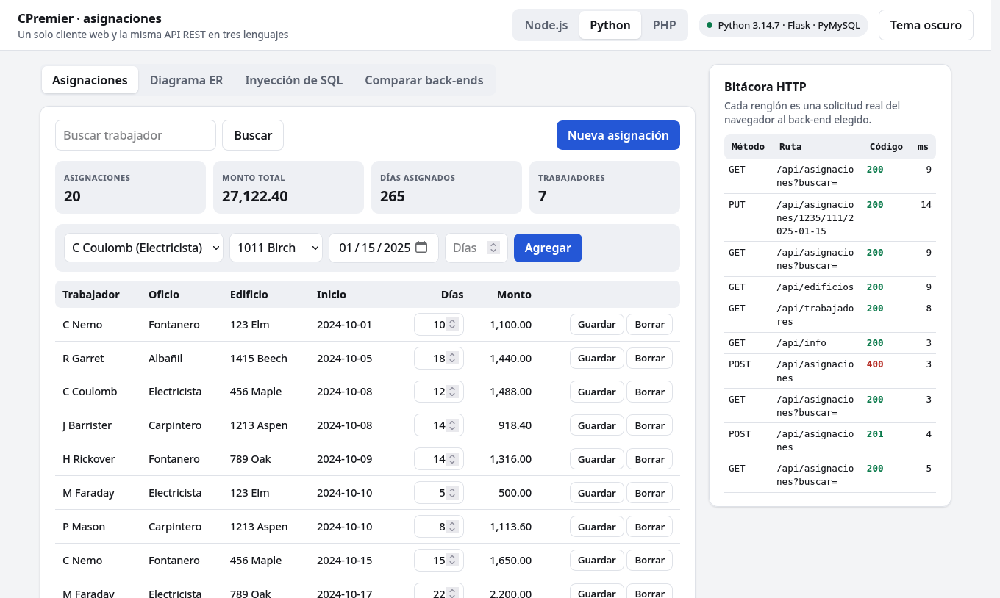
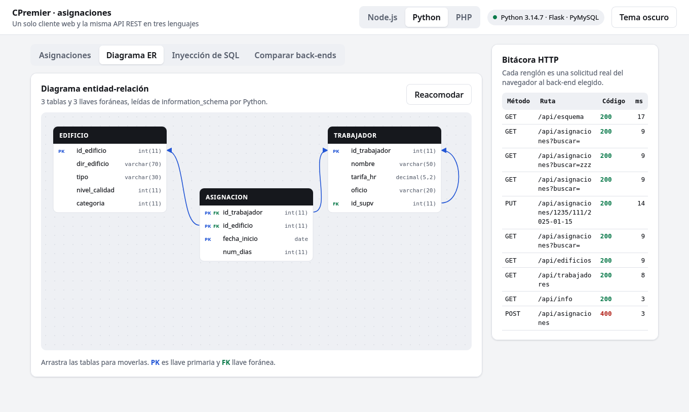
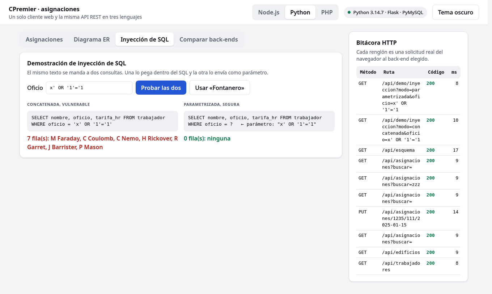
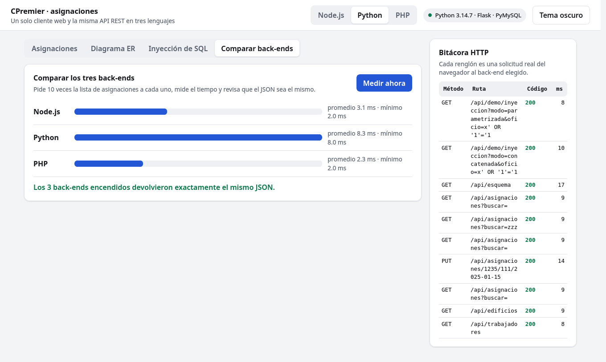

# TI06 · Prototipos HolaMundo de acceso a BD

Julio Cesar Ruiz Alfaro · Base de Datos · Ingeniería de Software 3° E · Universidad de Colima

Tres lenguajes (JavaScript, Python y PHP) y tres programas por lenguaje sobre la base CPremier en MySQL.

| Programa | JavaScript | Python | PHP |
|---|---|---|---|
| HolaMundo01, conexión y SELECT | consola | consola | consola |
| HolaMundo02, usuario, contraseña y consulta | web con Express | escritorio con Tkinter | web con PDO |
| HolaMundo03 (extra), API REST con CRUD | Express | Flask | PDO sin framework |

El HolaMundo03 es la misma API escrita tres veces. La carpeta `/cliente` tiene una sola página web que puede usar
cualquiera de las tres con un botón, y `/pruebas` trae un script que comprueba que las tres responden igual.

Los nueve usan consultas parametrizadas y ninguno trae credenciales en el código.

| CRUD y bitácora HTTP | Diagrama ER leído de la base |
|---|---|
|  |  |
| **Inyección de SQL, lado a lado** | **Comparación de los tres back-ends** |
|  |  |

## Versiones con las que se probó

| Lenguaje | Versión | Driver y librerías |
|---|---|---|
| JavaScript | Node.js 22.22 | mysql2 3.x, express 4.x, express-session 1.x |
| Python | Python 3.14 | PyMySQL 1.2, Flask 3.1, Tkinter (viene con Python) |
| PHP | PHP 8.3 | PDO con la extensión pdo_mysql |
| Servidor de BD | MariaDB 10.11, compatible con MySQL | |

## 1. Preparar la base de datos

Con un usuario administrador de MySQL o MariaDB:

```sql
CREATE DATABASE cpremier;
CREATE USER 'alumno'@'%' IDENTIFIED BY 'elige_una_contraseña';
GRANT SELECT ON cpremier.* TO 'alumno'@'%';
```

```bash
mysql -u root -p cpremier < sql/cpremier.sql
```

Ese usuario solo lee, que es lo único que necesitan HolaMundo01 y HolaMundo02. Para el HolaMundo03 hace falta un
usuario que además pueda escribir en la tabla de asignaciones:

```sql
CREATE USER 'app'@'%' IDENTIFIED BY 'elige_otra_contraseña';
GRANT SELECT ON cpremier.* TO 'app'@'%';
GRANT INSERT, UPDATE, DELETE ON cpremier.asignacion TO 'app'@'%';
```

## 2. Configurar la conexión

En cada carpeta copia `.env.example` como `.env` y escribe tus datos (host, puerto, base, usuario y contraseña).
HolaMundo01 lee usuario y contraseña de ahí. HolaMundo02 solo toma host, puerto y base, porque el usuario y la
contraseña se piden en pantalla.

## 3. Ejecutar

### JavaScript (`/javascript`)

```bash
npm install
npm run hola1                 # todos los trabajadores
npm run hola1 -- Fontanero    # filtrados por oficio
npm run hola2                 # abre http://localhost:3000
npm run hola3                 # API REST en http://localhost:3001
```

### Python (`/python`)

```bash
python -m venv .venv && source .venv/bin/activate    # en Windows: .venv\Scripts\activate
pip install -r requirements.txt
python holamundo01.py
python holamundo01.py Fontanero
python holamundo02.py         # abre la ventana de escritorio
python holamundo03_api.py     # API REST en http://localhost:3002
```

### PHP (`/php`)

Requiere la extensión `pdo_mysql` activa (`php -m` debe listarla).

```bash
php holamundo01.php
php holamundo01.php Fontanero
php -S localhost:8080 holamundo02.php    # abre http://localhost:8080
php -S localhost:3003 holamundo03_api.php    # API REST en http://localhost:3003
```

## Qué hace cada programa

- **HolaMundo01** se conecta, corre un SELECT de trabajadores con el nombre de su supervisor y lo imprime como tabla.
  Acepta un oficio como argumento, que se envía como parámetro de la consulta.
- **HolaMundo02** pide usuario y contraseña y valida el acceso intentando abrir la conexión con esos datos. Si MySQL
  los rechaza, muestra el aviso (las versiones web responden con HTTP 401). Si los acepta, muestra las asignaciones con
  días y monto, y un buscador por trabajador.

## HolaMundo03, un cliente y tres back-ends

Enciende una, dos o las tres APIs (con el usuario `app` en el `.env`) y abre cualquiera de ellas en el navegador,
por ejemplo http://localhost:3001. La página permite:

- Cambiar de back-end con los botones Node.js, Python y PHP. La pantalla sigue igual porque las tres APIs
  exponen los mismos endpoints y devuelven el mismo JSON.
- Hacer el CRUD completo de asignaciones (alta, cambio de días, baja y búsqueda), con totales al momento.
- Ver el diagrama entidad-relación de la base. La API lo lee de `information_schema` y las tablas se pueden arrastrar.
- Comparar los tres back-ends. Mide el tiempo de respuesta de cada uno y revisa que devuelvan el mismo JSON.
- Cambiar entre tema claro y oscuro.
- Ver en la bitácora cada solicitud HTTP con su método, ruta, código y tiempo.
- Probar la inyección de SQL. El mismo texto se manda a una consulta concatenada y a una parametrizada.

| Método y ruta | Qué hace | Códigos |
|---|---|---|
| GET /api/info | Lenguaje, framework y driver del back-end | 200 |
| GET /api/trabajadores, GET /api/edificios | Catálogos para el formulario | 200 |
| GET /api/esquema | Columnas y llaves foráneas, leídas de information_schema | 200 |
| GET /api/asignaciones?buscar= | Lista con monto, filtrada por trabajador | 200 |
| POST /api/asignaciones | Crea una asignación | 201, 400, 409 |
| PUT /api/asignaciones/{trabajador}/{edificio}/{fecha} | Cambia los días | 200, 400, 404 |
| DELETE /api/asignaciones/{trabajador}/{edificio}/{fecha} | Borra | 204, 404 |
| GET /api/demo/inyeccion?modo=&oficio= | Demostración de inyección | 200 |

Prueba de contrato, con las tres APIs encendidas:

```bash
python pruebas/probar_apis.py
```

Corre 15 comprobaciones en cada back-end y verifica que los tres devuelvan el mismo JSON en la lista y en el esquema. Crea una asignación de
prueba y la borra al terminar.

La ruta `/api/demo/inyeccion` con `modo=concatenada` es vulnerable a propósito, solo hace un SELECT y existe para
enseñar el problema. La API no pide inicio de sesión y escucha solo en `localhost`.

## Seguridad

- Consultas parametrizadas en todos los casos (`?` en mysql2, `%s` en PyMySQL, `:nombre` en PDO).
- Sin credenciales en el código. El archivo `.env` no se entrega.
- En las versiones web la contraseña queda en la sesión del servidor, la cookie es `HttpOnly` y la salida HTML se escapa.
- Son prototipos de clase. Para producción faltaría HTTPS, protección CSRF y un almacén de sesiones persistente.
